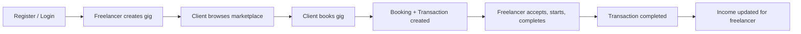
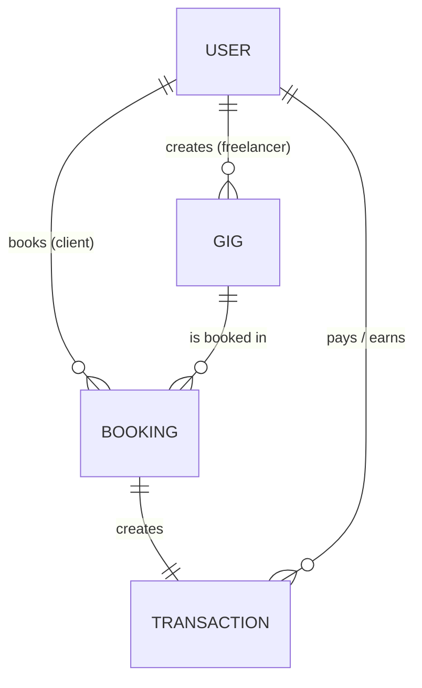
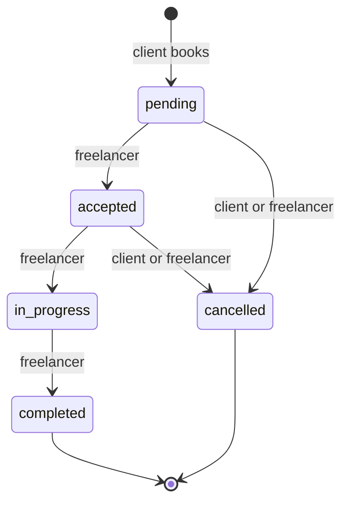
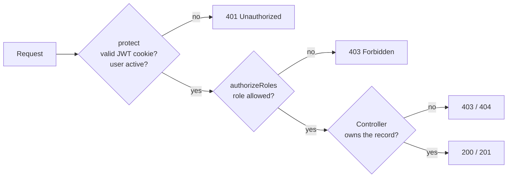

# HustleHub+: Secure MERN Freelance Marketplace

**INSY7314 POE, Part 3: Secure Stack** · Group 1

HustleHub+ is a full-stack MERN (MongoDB, Express, React, Node.js) marketplace. **Freelancers** list services ("gigs"), **clients** browse and book them, and **admins** oversee the platform. Part 2 extended the Part 1 HTTPS and authentication backend into a secured application. Part 3 adds an income and tax dashboard, CI checks, and SonarQube Cloud analysis in a companion repository. The application includes:

- a marketplace API (gigs, bookings, transactions and income)
- role-based access control (RBAC)
- input validation and sanitisation
- rate limiting
- security headers with a Content Security Policy
- a React frontend
- automated backend and frontend tests
- tax-year income summaries and an indicative SARS-based tax estimate
- GitHub Actions checks for tests, builds, API integration, and static analysis

> The Part 1 architecture report, diagram and screenshots are kept in [`docs/Part1-Report.md`](docs/Part1-Report.md).

---

## Table of contents

1. [Team and contributions](#1-team-and-contributions)
2. [Features](#2-features)
3. [Tech stack](#3-tech-stack)
4. [Project structure](#4-project-structure)
5. [Getting started](#5-getting-started)
6. [Backend API](#6-backend-api)
7. [Role-based access control (RBAC)](#7-role-based-access-control-rbac)
8. [API security: JWT, validation and sanitisation](#8-api-security-jwt-validation-and-sanitisation)
9. [Rate limiting and security headers](#9-rate-limiting-and-security-headers)
10. [React frontend](#10-react-frontend)
11. [Testing](#11-testing)
12. [Screenshots](#12-screenshots)
13. [Demonstration video](#13-demonstration-video)
14. [What changed from Part 1](#14-what-changed-from-part-1)
15. [References](#15-references)
16. [Part 3 income, CI and static analysis](#16-part-3-income-ci-and-static-analysis)

---

## 1. Team and contributions

| Student number | Name |
| --- | --- |
| ST10258513 | Clifford Naude |
| ST10453370 | Ruan Helgaard Hartman |
| ST10438433 | Caleb Forbes |
| ST10437348 | Alexandro Ornelas |

Part 2 was split by marking criterion.

| Area (marks) | Owner | What was delivered | README section |
| --- | --- | --- | --- |
| Backend API / application functionality (20) | `Ruan Helgaard Hartman` | Gig, booking, transaction, income, admin and user endpoints; Mongoose models; booking lifecycle; simulated payment and transaction records; income aggregation; API usage logging; seed data | [6](#6-backend-api) |
| RBAC enforcement (15) | `Alexandro Ornelas` | `protect` + `authorizeRoles` middleware, per-route role rules, ownership checks on gigs, bookings and transactions, admin-only routes, no Admin self-registration | [7](#7-role-based-access-control-rbac) |
| API security: JWT, validation, sanitisation (15) | `Clifford Naude` | HttpOnly cookie JWT, account re-check on every request, express-validator rules, marketplace validators, NoSQL/XSS rejection, safe error handling, CSRF origin check | [8](#8-api-security-jwt-validation-and-sanitisation) |
| Rate limiting and security headers (20) | `Alexandro Ornelas` | `express-rate-limit` on auth and booking routes, Helmet configuration, API and frontend Content Security Policies, CORS | [9](#9-rate-limiting-and-security-headers) |
| React frontend (10) | `Clifford Naude` | React 19 + Vite app, auth context, protected and role routes, client/freelancer/admin pages, error and loading states, HTTPS dev server | [10](#10-react-frontend) |
| Backend testing, frontend testing, README, GitHub (20) |  `Caleb Forbes` | Updated Part 1 tests for cookie auth; new RBAC/security tests; Part 2 Postman collection and Newman scripts; rate-limit demo; Vitest + React Testing Library suite; README; repository management | [11](#11-testing) |


Part 3 was split by marking criterion.

| Area (marks) | Owner | What was delivered | README section |
| --- | --- | --- | --- |
| Docker Backend and Frontend (10) | `Ruan Helgaard Hartman` | The application is dockerized into containers | [6](#6-backend-api) |
| Security Review in README (10) | `Ruan Helgaard Hartman` | Updated README | [6](#6-backend-api) |
| README Updates (5) | `Ruan Helgaard Hartman` | Updated README | [6](#6-backend-api) |
| CI/CD Pipeline Backend && Frontend (20) | `Alexandro Ornelas` | GitHub Actions backend, frontend, Newman and build checks | [16](#16-part-3-income-ci-and-static-analysis) |
| Static Code Analysis (10) | `Alexandro Ornelas` | ESLint and backend syntax check here; SonarQube Cloud evidence in the companion repository | [16](#16-part-3-income-ci-and-static-analysis) |
| Logging (10) |  `Caleb Forbes` | work to be noted | [11](#11-testing) |
| 2 Security Features (15) |  `Caleb Forbes` | work to be noted | [11](#11-testing) |
| Tax + Income Dashboard (20) | `Clifford Naude` | SARS 2027 progressive estimate and responsive earnings dashboard | [16](#16-part-3-income-ci-and-static-analysis) |

---

## 2. Features

### What each role can do

| Capability | Visitor | Client | Freelancer | Admin |
| --- | :---: | :---: | :---: | :---: |
| Register / log in | ✅ | N/A | N/A | N/A |
| Browse, search and filter the marketplace | ✅ | ✅ | ✅ | ✅ |
| View gig details | ✅ | ✅ | ✅ | ✅ |
| Book a gig (simulated payment) | ❌ | ✅ | ❌ | ❌ |
| View own bookings and transactions | ❌ | ✅ | ✅ | ✅ (all) |
| Create, edit, pause and delete **own** gigs | ❌ | ❌ | ✅ | ❌ |
| Accept, start and complete bookings on own gigs | ❌ | ❌ | ✅ | ✅ |
| Cancel a booking | ❌ | ✅ (own) | ✅ (own) | ✅ |
| Freelancer dashboard and income page | ❌ | ❌ | ✅ | ❌ |
| Edit or deactivate own profile | ❌ | ✅ | ✅ | ✅ |
| Manage users, moderate gigs and bookings | ❌ | ❌ | ❌ | ✅ |
| Analytics and API usage reports | ❌ | ❌ | ❌ | ✅ |

### End-to-end flow



---

## 3. Tech stack

| Layer | Technology |
| --- | --- |
| Frontend | React 19, React Router 7, Vite 8 |
| Backend | Node.js, Express 5 (served over HTTPS) |
| Database | MongoDB with Mongoose 8 (local MongoDB or Atlas); `migrate-mongo` for indexes |
| Auth | `jsonwebtoken`, `bcryptjs`, `cookie-parser` |
| Security | `helmet`, `express-rate-limit`, `express-validator`, `cors` |
| Backend tests | Node.js test runner (`node --test`), Postman, Newman + `newman-reporter-htmlextra` |
| Frontend tests | Vitest, React Testing Library, `@testing-library/user-event`, jsdom |

---

## 4. Project structure

```text
.
├── README.md
├── docs/Part1-Report.md               Part 1 architecture report
├── PostmanCollection/                 Part 1 + Part 2 collections, rate-limit demo
├── NewmanReports/                     HTML reports produced by Newman
├── Screenshots/                       Application and test evidence
└── Project/
    ├── .env.example                   Backend environment template
    ├── package.json                   Root scripts (dev, seed, tests, Newman)
    ├── migrations/                    MongoDB index migrations
    ├── server/
    │   ├── app.js                     Express app: Helmet/CSP, CORS, origin check, rate limiters, routes
    │   ├── server.js                  HTTPS start-up (fails fast if config is missing)
    │   ├── config/                    Database connection, HTTPS certificate loading
    │   ├── controllers/               auth, user, gig, booking, transaction, income, admin
    │   ├── middleware/                protect, authorizeRoles, validators, error handler, API usage
    │   ├── models/                    User, Gig, Booking, Transaction, Review, Analytics, ApiUsage
    │   ├── routes/
    │   ├── scripts/                   Certificate generator, seed data
    │   └── test/                      Backend automated tests
    └── client/
        ├── vite.config.js             HTTPS dev server + CSP headers
        ├── vitest.config.js           Frontend test configuration
        └── src/
            ├── context/AuthContext.jsx
            ├── routes/                ProtectedRoute, RoleRoute
            ├── components/layout/     Navbar, Footer, Layout
            ├── pages/                 auth, marketplace, gig, bookings, transactions, dashboard, profile, admin
            ├── test/                  Test setup and helpers
            └── __tests__/             Frontend automated tests
```

---

## 5. Getting started

### Prerequisites

- Node.js 20 LTS or newer
- MongoDB running locally (`mongodb://127.0.0.1:27017`) **or** a MongoDB Atlas connection string
- OpenSSL, used once to generate the local HTTPS certificate. Git for Windows includes it.
- Postman (optional, because Newman runs the same collection from the terminal)

### Step 1: Install dependencies

```bash
cd Project
npm install
npm install --prefix server
npm install --prefix client
```

### Step 2: Environment variables

**Backend:** create `server/.env`:

```env
PORT=5000
MONGO_URI=mongodb://127.0.0.1:27017/
JWT_SECRET=replace-with-a-long-random-string
JWT_EXPIRES_IN=7d
```

**Project Root:** create `Project/.env` (copy `Project/.env.example`):
```emv
MONGO_URI="local host using mongoDB compass or cloud using mongoDB atlas"

//When deploying, set NODE_ENV to production
NODE_ENV=development
MONGO_DB_DEV=test
MONGO_DB_PROD=INSY7314HustleHub+
MONGO_DB_NAME="INSY7314HustleHub+"

JWT_SECRET=node -e "console.log(require('crypto').randomBytes(64).toString('hex'))"

CLIENT_ORIGIN=https://localhost:5173

SSL_KEY_PATH=server\certificates\localhost-key.pem
SSL_CERT_PATH=server\certificates\localhost-cert.pem
```
Important Note, for development: NODE_ENV=development
For Production: NODE_ENV=production
This switches DBs from testing seeded data to production data and prevents accidental mix of data.

> `MONGO_DB_NAME` must contain `dev`, `local` or `test`. The seed script refuses to run on any other name, so it can never wipe a production database.
> Generate a strong secret with `node -e "console.log(require('crypto').randomBytes(48).toString('hex'))"`.

**Frontend:** create `Project/client/.env` (copy `Project/client/.env.example`):

```env
VITE_API_URL=https://localhost:5000
VITE_APP_NAME=HustleHub+
```

`.env` files and certificates are git-ignored and must never be committed.

### Step 3: Certificate and seed data

```bash
npm run generate-cert
npm run seed
```

Seeded accounts (password `Password123!`):

| Role | Email |
| --- | --- |
| Client | `client@hustlehub.test` |
| Freelancer | `john@hustlehub.test`, `sarah@hustlehub.test` |
| Admin | `admin@hustlehub.test` |

### Step 4: Run

```bash
npm run dev
```

| App | URL |
| --- | --- |
| Backend API | <https://localhost:5000> |
| Frontend | <https://localhost:5173> |

Both use a self-signed certificate. Open <https://localhost:5000> once and accept the browser warning, otherwise the frontend cannot reach the API. Then open <https://localhost:5173>.

To run them separately: `npm run server` and `npm run client`.

---

## 6. Backend API

The Express API is the core of the application: every business rule and every security check runs on the server.

### 6.1 Data model



| Collection | Key fields | Notes |
| --- | --- | --- |
| `users` | name, email (unique, lowercase), password (bcrypt hash), role (`Client` / `Freelancer` / `Admin`), isActive, bio, skills, phone, location | Deactivated users cannot log in or use existing tokens |
| `gigs` | freelancerId → User, title, description, category, price, deliveryDays, location.address, status (`active` / `paused` / `deleted`), views | Delete is a soft delete, so booking history stays intact |
| `bookings` | gigId, clientId, freelancerId, agreedPrice, bookingDate, status, completedAt | `agreedPrice` is copied from the gig at booking time |
| `transactions` | bookingId (unique), clientId, freelancerId, amount, platformFee, taxAmount, freelancerAmount, status, invoiceNumber, payoutDate | Exactly one per booking |
| `apiusages` | date, endpoint, method, statusCode, successful | Written by middleware on every request |
| `reviews`, `analytics` | Not used in Part 2 | Supporting collections |

Indexes are created by the `migrate-mongo` migrations in `Project/migrations/`.

### 6.2 Booking and simulated payment

When a client books a gig (`POST /api/bookings`):

1. The server loads the gig. It must be `active`, and a freelancer cannot book their own gig.
2. A **booking** is created. The client is the logged-in user, and the price is copied **from the database**. Any price in the request body is ignored.
3. A **transaction** is created and linked to the booking, the client and the freelancer:

| Field | Calculation | Example (R1 000 gig) |
| --- | --- | --- |
| `amount` | gig price | R1 000.00 |
| `platformFee` | 10% of amount | R100.00 |
| `taxAmount` | R0.00 for new transactions; the annual estimate is calculated separately | R0.00 |
| `freelancerAmount` | amount - fee | R900.00 |
| `invoiceNumber` | `INV-<bookingId>` | `INV-6650…` |

If the transaction cannot be saved, the booking is rolled back, so a booking never exists without its transaction.

### 6.3 Booking lifecycle



- Completing a booking sets the transaction to `completed`; cancelling sets it to `refunded`.
- Any other jump (for example `pending → completed`) is rejected with `400`.
- Admins can record a **payout** on a completed transaction (`PATCH /api/transactions/:id/payout`). It can only be done once.

### 6.4 Income tracking

`GET /api/income` returns the logged-in freelancer's current South African tax-year totals from completed transactions and bookings. It groups each payment by the booking's completion date:

- **period:** tax year and its 1 March to 28 February bounds
- **summary:** gross earnings, platform fees, taxable platform income, estimated annual tax, income after estimated tax, and any historical recorded tax deductions
- **monthlyIncome:** twelve months of earnings after fees and before estimated tax
- **taxMethod:** the rate year, primary rebate, SARS source, and calculation assumptions

### 6.5 Admin and monitoring

- **Dashboard:** user counts by role, active gigs, bookings, completed bookings, platform revenue (fees from completed bookings) and total API requests.
- **Management:** users (role and active status; an admin cannot remove their own Admin role), gigs (pause or remove) and bookings (status).
- **API usage:** every request is logged with its endpoint, method and status code, then grouped by day and endpoint into success and failure counts.

### 6.6 Endpoint reference

All routes are relative to `https://localhost:5000`. 🔒 = valid JWT cookie required.

**Auth**

| Method | Route | Access | Description |
| --- | --- | --- | --- |
| POST | `/api/auth/register` | Public · rate limited | Register a Client or Freelancer |
| POST | `/api/auth/login` | Public · rate limited | Log in; sets the HttpOnly JWT cookie |
| GET | `/api/auth/me` | 🔒 Any role | Current user |
| POST | `/api/auth/logout` | Public | Clears the cookie |

**Users**

| Method | Route | Access | Description |
| --- | --- | --- | --- |
| GET / PUT | `/api/users/profile` | 🔒 Any role | View or update own profile |
| DELETE | `/api/users/profile` | 🔒 Any role | Deactivate own account |
| GET | `/api/users/:id` | 🔒 Any role | Public profile of a user |
| GET | `/api/users` | 🔒 Admin | List users |
| DELETE | `/api/users/:id` | 🔒 Admin | Remove a user |

**Gigs**

| Method | Route | Access | Description |
| --- | --- | --- | --- |
| GET | `/api/gigs` | Public | Active gigs (`search`, `category`, `minPrice`, `maxPrice`) |
| GET | `/api/gigs/:id` | Public | One active gig |
| GET | `/api/gigs/my-gigs` | 🔒 Freelancer | Own gigs |
| GET | `/api/gigs/my-gigs/:id` | 🔒 Freelancer (owner) | Own gig for editing (including paused) |
| POST | `/api/gigs` | 🔒 Freelancer | Create gig |
| PUT | `/api/gigs/:id` | 🔒 Freelancer (owner) | Update own gig |
| DELETE | `/api/gigs/:id` | 🔒 Freelancer (owner) | Soft-delete own gig |

**Bookings, transactions and income**

| Method | Route | Access | Description |
| --- | --- | --- | --- |
| POST | `/api/bookings` | 🔒 Client · rate limited | Book a gig and create its transaction |
| GET | `/api/bookings/my-bookings` | 🔒 Any role | Bookings where the user is client or freelancer |
| GET | `/api/bookings/:id` | 🔒 Party to booking / Admin | One booking |
| PATCH | `/api/bookings/:id/status` | 🔒 Owning freelancer (client may cancel) | Move through the lifecycle |
| GET | `/api/transactions/my-transactions` | 🔒 Any role | Own transactions |
| GET | `/api/transactions/:id` | 🔒 Party to transaction / Admin | One transaction (invoice) |
| PATCH | `/api/transactions/:id/payout` | 🔒 Admin | Record a payout |
| GET | `/api/income` | 🔒 Freelancer | Income summary and monthly breakdown |

**Admin** (all 🔒 Admin)

| Method | Route | Description |
| --- | --- | --- |
| GET | `/api/admin` | Dashboard statistics |
| GET | `/api/admin/users` | List users |
| GET / PUT | `/api/admin/users/:id` | View or update a user |
| GET | `/api/admin/gigs` | List gigs |
| PUT / DELETE | `/api/admin/gigs/:id` | Moderate or remove a gig |
| GET | `/api/admin/bookings` | List bookings |
| PUT | `/api/admin/bookings/:id` | Update a booking |
| GET | `/api/admin/analytics` | Analytics |
| GET | `/api/admin/api-usage` | API usage report |

---

## 7. Role-based access control (RBAC)

RBAC is enforced **on the server**. The React route guards only improve the user experience. Hiding a link is not security.

### 7.1 How a request is authorised



```js
// middleware/authMiddleware.js
const authorizeRoles = (...allowedRoles) => (req, res, next) => {
  if (!req.user || !allowedRoles.includes(req.user.role)) {
    return res.status(403).json({ message: "You do not have permission to perform this action." });
  }
  next();
};

// routes/gigRoutes.js
router.post("/", protect, authorizeRoles("Freelancer"), validateGig, createGig);
```

### 7.2 Role rules

| Rule | Where |
| --- | --- |
| Only **Freelancers** create, edit or delete gigs and see income | `gigRoutes.js`, `incomeRoutes.js` |
| Only **Clients** create bookings | `bookingRoutes.js` |
| Only **Admins** reach `/api/admin/*`, list or delete users, and record payouts | `adminRoutes.js`, `userRoutes.js`, `transactionRoutes.js` |
| Public registration accepts only `Client` or `Freelancer`, never `Admin` | `validateRegistration.js`, `authController.js` |
| An admin cannot remove their own Admin role | `adminController.js` |

### 7.3 Ownership: users cannot touch data that isn't theirs

| Resource | Check | Result for a non-owner |
| --- | --- | --- |
| Gig update / delete / edit view | Query filter includes `freelancerId: req.user.id` | `404 Not found` (existence is not revealed) |
| Booking view | User must be the client, the freelancer or an admin | `403` |
| Booking status change | Only the owning freelancer; the owning client may only cancel | `403` |
| Transaction view | User must be the client, the freelancer or an admin | `403` |
| Lists (my gigs, bookings, transactions, income) | Always filtered by the logged-in user's ID | Only own records returned |

The owner and the price are **never taken from the request body**: `freelancerId`, `clientId` and all money values come from the token and the database, so they cannot be spoofed.

---

## 8. API security: JWT, validation and sanitisation

### 8.1 Authentication with JWT

- Passwords are hashed with **bcrypt** (10 salt rounds) and never returned by the API.
- After login the server signs a JWT that contains only the user ID and role, and expires after 1 hour (`JWT_EXPIRES_IN`).
- The token is stored in a cookie with these flags:

  | Flag | Protection |
  | --- | --- |
  | `HttpOnly` | JavaScript cannot read the token, so XSS cannot steal it |
  | `Secure` | Sent over HTTPS only |
  | `SameSite=Lax` | Not sent on cross-site POST requests (CSRF) |

  The frontend never stores tokens in `localStorage`.
- `protect` verifies the signature and expiry on every protected request, then reloads the user from the database. Deleted or deactivated accounts are rejected immediately, even while their token is still valid.
- Login failures always return `Invalid email or password.`, so attackers cannot find out which emails are registered.
- `server.js` refuses to start without `MONGO_URI` and `JWT_SECRET`, and secrets live only in git-ignored `.env` files.

### 8.2 Input validation and sanitisation

| Input | Validation |
| --- | --- |
| Registration | `express-validator`: name 2 to 100 characters with no `<` or `>`; valid email (trimmed and normalised); password 8 to 128 characters with uppercase, lowercase, number and special character; role `Client` or `Freelancer` |
| Login | Email and password must be strings of a valid length; objects are rejected |
| Gig | Text fields must be strings of a limited length with no `<` or `>`; price a number from 0 to 10 000 000 with at most 2 decimals; delivery 1 to 365 days; image URL must start with `http(s)://`; status `active` or `paused` |
| Booking | `gigId` must be a valid ObjectId; date from today up to 1 year ahead |
| Profile | Name, phone, bio, skills and location are type- and length-checked, with no `<` or `>` |
| URL IDs | `validateId` rejects invalid ObjectIds before the database is queried |
| Search | Trimmed, limited to 80 characters and regex-escaped |
| Body size | JSON limited to 32 KB (`413` if larger); malformed JSON returns `400` |

**How this stops injection and scripting attacks:**

- **NoSQL injection:** operator objects such as `{"$gt": ""}` fail the type checks, so they never reach a MongoDB query.
- **XSS:** tags are rejected at input. React also escapes everything it renders, and no page uses `dangerouslySetInnerHTML`. The CSP (section 9) is a further layer.
- **Information leakage:** validation errors return field names and messages but never the submitted values, so passwords are not echoed back.

### 8.3 CSRF and CORS

- **CORS** allows only `CLIENT_ORIGIN`, with credentials.
- Any `POST`, `PUT`, `PATCH` or `DELETE` whose `Origin` header is not the trusted client is rejected with `403 Request origin is not allowed.` This adds to the protection from `SameSite=Lax` cookies.

### 8.4 Safe error handling

A central error handler returns controlled JSON for `400`, `401`, `403`, `404`, `409`, `413` and `500`. Stack traces, Mongoose errors, file paths and connection strings are never sent to the client, and unexpected errors are logged without credentials. Public gig listings populate only a freelancer's name, picture and rating, never their email or password.

---

## 9. Rate limiting and security headers

### 9.1 Rate limiting

`express-rate-limit` is configured in `app.js`:

| Endpoint | Limit (per IP) | Response when exceeded |
| --- | --- | --- |
| `POST /api/auth/login`, `POST /api/auth/register`, `POST /api/users` | 30 requests / 15 minutes | `429` `{"message":"Too many authentication attempts. Try again later."}` |
| `POST /api/bookings` | 20 bookings / hour | `429` `{"message":"Booking limit reached. Try again later."}` |

- The login limit slows brute-force and credential-stuffing attacks. The booking limit stops automated booking spam.
- Every response carries the standard `RateLimit` and `RateLimit-Policy` headers (IETF draft-7), so clients can see the limit and how many requests are left. Legacy `X-RateLimit-*` headers are turned off.
- The frontend shows the 429 message to the user (tested in `NewBooking.test.jsx`).

```js
const loginLimiter = rateLimit({
  windowMs: 15 * 60 * 1000,
  limit: 30,
  standardHeaders: "draft-7",
  legacyHeaders: false,
  message: { message: "Too many authentication attempts. Try again later." }
});
```

### 9.2 Security headers (Helmet)

Helmet runs before every route.

| Header | Protects against |
| --- | --- |
| `Content-Security-Policy` | XSS, injected scripts, clickjacking, data exfiltration |
| `Strict-Transport-Security` | Downgrade to HTTP |
| `X-Content-Type-Options: nosniff` | MIME-type sniffing |
| `X-Frame-Options` | Clickjacking |
| `Referrer-Policy` | Leaking URLs to other sites |
| `Cross-Origin-Opener-Policy`, `Cross-Origin-Resource-Policy` | Cross-origin attacks |
| `X-Powered-By` removed | Revealing that the server runs Express |

### 9.3 Content Security Policy

**API CSP** (`app.js`):

```text
default-src 'self'; base-uri 'self'; object-src 'none'; frame-ancestors 'none';
script-src 'self'; style-src 'self'; img-src 'self' data: https:;
connect-src 'self' https://localhost:5173
```

**Frontend CSP** (`vite.config.js`), sent by the Vite server:

| Directive | Preview / production | Development |
| --- | --- | --- |
| `script-src` | `'self'` | `'self' 'unsafe-inline'` (React refresh preamble) |
| `style-src` | `'self' 'unsafe-inline'` | same |
| `connect-src` | `'self'` + API origin | + `wss://localhost:5173` (hot reload) |
| `object-src` / `frame-ancestors` / `base-uri` | `'none'` / `'none'` / `'self'` | same |

Scripts can load only from the app itself, plugins and framing are blocked, `<base>` tags cannot redirect links, and the page can only send data to its own API.

---

## 10. React frontend

The frontend is a React 19 single-page app built with Vite and React Router 7. It runs over HTTPS in development.

### 10.1 Pages

| Area | Route | Page |
| --- | --- | --- |
| Public | `/` | Home / landing page |
| | `/marketplace` | Browse gigs with search and category filter |
| | `/gigs/:id` | Gig details with a "Book" action |
| | `/login`, `/signup` | Authentication |
| Any logged-in user | `/profile` | View, edit or deactivate profile |
| | `/bookings` | Bookings list with status actions |
| Client and Freelancer | `/transactions` | Transaction history |
| Client | `/bookings/new?gigId=` | Booking confirmation (simulated payment) |
| Freelancer | `/dashboard` | Income summary, recent activity, quick actions |
| | `/my-gigs`, `/create-gig`, `/gigs/:id/edit` | Gig management (create, edit, pause, delete) |
| | `/income` | Income breakdown and monthly income |
| Admin | `/admin` | Dashboard |
| | `/admin/users`, `/admin/users/:id/edit` | User management |
| | `/admin/gigs`, `/admin/bookings` | Moderation |
| | `/admin/analytics`, `/admin/api-usage` | Reports |
| Any | `*` | Not found page |

### 10.2 Authentication and route protection

- **`AuthContext`** restores the session on load by calling `/api/auth/me` with `credentials: "include"`. The token itself stays in the HttpOnly cookie and never reaches JavaScript.
- **`ProtectedRoute`** shows a loading state while the session is restored, then sends logged-out users to `/login`.
- **`RoleRoute`** sends users away from pages for other roles.
- After login, users are redirected by role: Admin → `/admin`, Freelancer → `/dashboard`, Client → `/`.
- The **Navbar** only shows links for the current role and includes Logout.

### 10.3 Usability and safe input handling

- Every data page has **loading**, **empty** and **error** states (for example "No bookings yet").
- API error messages are shown as given (for example "Invalid email or password." or the 429 message). The UI never shows stack traces or tokens.
- Forms use HTML5 validation (`required`, `type="email"`, a minimum date) and client checks such as password confirmation and numeric price. The server still validates everything.
- Destructive actions (deleting a gig, deactivating a user) ask for confirmation first.
- Booking sends only `gigId` and the date. The price shown is for display only and is never trusted by the API.

---

## 11. Testing

| Suite | Tool | Location | Result |
| --- | --- | --- | --- |
| Backend unit/integration | `node --test` | `Project/server/test/` | Run by CI |
| API end-to-end | Postman + Newman | `PostmanCollection/` | 69 requests, 169 assertions |
| Rate-limit demo | Newman (35 iterations) | `PostmanCollection/` | `429` after 30 attempts |
| Frontend | Vitest + React Testing Library | `Project/client/src/__tests__/` | Run by CI |

Run every command from the `Project` folder.

### 11.1 Backend automated tests

```bash
npm run test:server
```

The API tests start the real Express app over HTTPS on a random port. Controller and model tests isolate database calls, so **MongoDB is not needed** for this suite.

- **`api.test.js`** (Part 1, updated for cookie auth) covers:
  - HTTPS and the certificate
  - registration validation, password hashing and duplicate handling
  - the login cookie (`HttpOnly`, `Secure`, no token in the body)
  - malformed, expired and forged JWTs, and `403` for the wrong role
  - malformed and oversized JSON, and safe 500 errors
- **`marketplace-security.test.js`** (Part 2) covers:
  - Helmet and CSP headers, and the CSRF origin check
  - RBAC for gigs, bookings, admin and income
  - ownership of gigs and transactions
  - owner spoofing and price tampering
  - transaction fee and payout calculation; annual tax estimation has separate tests
  - XSS and NoSQL-injection rejection, and invalid IDs
  - both rate limiters returning `429`

### 11.2 Postman collection and Newman

**`HustleHub Part 2 - Secure Marketplace API`** registers fresh users on every run, then tests the full flow in folders:

| Folder | Success and failure cases |
| --- | --- |
| 0. Health & Security Headers | HTTPS; CSP, HSTS, nosniff and X-Frame-Options present; X-Powered-By hidden |
| 1. Registration & Login Validation | Valid registration; duplicate (409); weak password; XSS in name; Admin self-registration blocked; missing fields; generic login error; NoSQL injection; malformed JSON |
| 2. Freelancer - Gig Management | HttpOnly/Secure login cookie; create, update and list own gigs; bad gig data rejected; freelancer can't book or reach admin |
| 3. Client - Browse & Book | Public browsing hides private fields; regex search is escaped; client can't create, edit or delete gigs or see income; invalid bookings rejected; booking creates a transaction with server-side price and correct fees |
| 4. Freelancer - Bookings & Income | Invalid status jump rejected; accept → start → complete; transaction completed; income includes the net amount |
| 5. Ownership - Other Freelancer | A second freelancer can't edit, delete or view the first freelancer's gig, booking or transaction |
| 6. Admin | Dashboard, user list without password hashes, any transaction, all bookings |
| 7. Token & Session Security | Rejected after logout; forged JWT rejected; foreign Origin blocked; controlled 404 |

Run it with Newman (backend running, database seeded):

```bash
npm run dev          # terminal 1
npm run test:api     # terminal 2  → NewmanReports/newman-report.html
```

Run the rate-limit demo **last**, because it locks login for 15 minutes. Restart the server to reset it:

```bash
npm run test:ratelimit   # → NewmanReports/newman-ratelimit-report.html
```

**Newman HTML report:** 
The report is saved in the repository at [`NewmanReports/newman-report.html`](NewmanReports/newman-report.html).

> The main collection makes about 14 login and register calls, so it can run twice in 15 minutes before the login limit applies. Restart the backend to reset the in-memory counter.
>
> To use the Postman app instead: import the collection, turn **SSL certificate verification** off (the certificate is self-signed) and click *Run collection*. Postman handles the auth cookie automatically.

### 11.3 Frontend automated tests

```bash
npm run test:client
```

| Test file | Rendering | User interaction |
| --- | --- | --- |
| `Login.test.jsx` | Form, fields, button | Typing; wrong password shows a safe error; cookie sent; redirect by role |
| `Signup.test.jsx` | Fields; Admin not offered | Password mismatch blocked; API error shown; correct payload; redirect |
| `Marketplace.test.jsx` | Loading → gigs; `<script>` rendered as text | Search and category filters; empty state; API failure |
| `NewBooking.test.jsx` | Gig, price and location | Only `gigId` and date sent; redirect; 429 message shown |
| `RouteGuards.test.jsx` | Loading state | Logged-out → login; wrong role → home; right role sees the page |
| `Navbar.test.jsx` | Links per role | Logout calls `logout()` |

`fetch` is mocked, so these tests need neither the backend nor the database.

### 11.4 Run everything

```bash
npm run test:all     # backend + frontend automated tests
npm run test:api     # Newman (backend must be running)
```

---

## 12. Screenshots

### 12.1 Visitor: Browsing and registration


*Figure 1: The public marketplace lists active gigs with search and category filters. No login is needed to browse.*


*Figure 2: Sign-up rejects a weak password. The API's validation message is shown to the user, and the submitted password is never echoed back.*


*Figure 3: Sign-up rejects a password shorter than 8 characters.*

### 12.2 Freelancer: Gig management and income


*Figure 4: A freelancer creates a gig with a title, description, category, price, delivery time and location. The server validates every field.*


*Figure 5: My Gigs shows only the logged-in freelancer's own gigs, with View, Edit and Delete actions.*


*Figure 6: Historical Part 2 transaction screenshot showing R5 000 gross, a R500 platform fee and the former flat simulated tax deduction. Part 3 records no tax deduction on new transactions; its tax-year estimate appears on the income page.*


*Figure 7: Historical Part 2 income screenshot. The Part 3 income page now shows the current tax year, twelve monthly values and a separate annual tax estimate.*

### 12.3 Client: Booking a gig


*Figure 8: A client books a gig. Payment is simulated, and the agreed price comes from the gig in the database, not from the browser.*


*Figure 9: The client's bookings appear as pending, with the date, price and location. The client can view the gig or cancel.*

### 12.4 Admin: Platform oversight


*Figure 10: Only Admins can see and manage all user accounts and their roles (Client, Freelancer, Admin).*


*Figure 11: Admins can moderate gigs from every freelancer.*


*Figure 12: Admins see every booking on the platform, including the completed R5 000 booking shown in Figure 6.*


*Figure 13: API usage monitoring: every request is logged and summarised as successful or failed.*

### 12.5 Testing evidence


*Figure 14: Backend automated tests (`npm run test:server`): 35 passed, 0 failed. They cover HTTPS, JWT cookies, RBAC, ownership, validation, security headers and rate limiting.*


*Figure 15: Frontend tests with Vitest and React Testing Library (`npm run test:client`): 6 files, 29 tests passed. The `stderr` line is expected, because one test deliberately simulates the API failing.*


*Figure 16: The Part 2 Postman collection run with Newman (`npm run test:api`): 69 requests and 169 assertions, 0 failed.*


*Figure 17: The Newman htmlextra report (`NewmanReports/newman-report.html`): 69 requests, 0 failed tests, 0 skipped.*


*Figure 18: The same collection run in the Postman app: 169 tests passed, 0 failed, 0 errors.*
*Proof of all the tests running:*


---

## 13. Demonstration video

**Part 3 video (unlisted):** (to be added)


**Part 2 video (unlisted):** https://youtu.be/XHeTo1fYRP4?si=5Fyyw8Du3gUsxQYT


Part 1 video: <https://youtu.be/_TZ8-mItvcw>

---

## 14. What changed from Part 1

| Area | Part 1 | Part 2 | Part 3 |
| --- | --- | --- |
| Scope | Backend authentication only | Full MERN marketplace: gigs, bookings, transactions, income, admin |
| Token storage | JWT in the response body, sent as `Authorization: Bearer` | `Secure` `HttpOnly` `SameSite=Lax` cookie, re-checked against the database on each request |
| Authorisation | Authentication only | RBAC (`authorizeRoles`) plus ownership checks on every resource |
| Validation | Registration and login | Plus gig, booking, profile and ID validators; HTML-tag and NoSQL-operator rejection; escaped search |
| Rate limiting | Planned | Login/register 30 per 15 min; bookings 20 per hour; `429` messages and `RateLimit` headers |
| Security headers | Planned | Helmet with a custom CSP on the API, and a CSP on the Vite server |
| CSRF | Not implemented | Origin check on state-changing requests |
| Frontend | Not built | React 19 app with protected and role routes for all three roles |
| Backend tests | 16 | 35 |
| Postman | 14 requests | 69 requests / 169 assertions with Newman, plus a rate-limit demo |
| Frontend tests | None | 29 Vitest + React Testing Library tests |

---

## 15. References

- Express. 2026. *Production best practices: security*. Available at: <https://expressjs.com/en/advanced/best-practice-security.html>
- Helmet. 2026. *Helmet.js documentation*. Available at: <https://helmetjs.github.io/>
- express-rate-limit. 2026. *express-rate-limit documentation*. Available at: <https://express-rate-limit.mintlify.app/>
- express-validator. 2026. *express-validator documentation*. Available at: <https://express-validator.github.io/docs/>
- MDN Web Docs. 2026. *Content Security Policy (CSP)*. Available at: <https://developer.mozilla.org/en-US/docs/Web/HTTP/CSP>
- OWASP Foundation. 2021. *OWASP Top 10*. Available at: <https://owasp.org/Top10/>
- OWASP Foundation. 2026. *Cheat Sheet Series: Authorization, Content Security Policy, Cross-Site Request Forgery Prevention, Input Validation*. Available at: <https://cheatsheetseries.owasp.org/>
- Postman. 2026. *Run collections using Newman CLI*. Available at: <https://learning.postman.com/docs/collections/using-newman-cli/command-line-integration-with-newman/>
- React. 2026. *React documentation*. Available at: <https://react.dev/>
- Testing Library. 2026. *React Testing Library*. Available at: <https://testing-library.com/docs/react-testing-library/intro/>
- Vitest. 2026. *Vitest guide*. Available at: <https://vitest.dev/guide/>

---

## 16. Part 3 income, CI and static analysis

### Income and tax dashboard

The freelancer `/income` page uses completed bookings in the current South African tax year (1 March to 28 February). The API groups earnings by **booking completion date**, rather than booking creation date, and returns twelve monthly values plus gross earnings, platform fees, estimated taxable platform income, indicative tax and income after estimated tax. The dashboard shows the same figures and explains the calculation.

The estimate uses the [SARS 2027 individual tax brackets and primary rebate](https://www.sars.gov.za/tax-rates/income-tax/rates-of-tax-for-individuals/). It applies the progressive bracket to completed earnings less platform fees, subtracts the R17,820 primary rebate and floors the result at zero. For example, R120,000 completed earnings less R12,000 fees gives R108,000 taxable platform income; 18% is R19,440, less the rebate gives **R1,620 estimated tax**. It assumes an individual under 65 with no other income, expenses, deductions or tax credits. It is an estimate, not tax withheld or a final tax assessment. The fixed 2027 rates require review for future tax years.

New simulated transactions deduct the 10% platform fee and record zero tax withheld. Older transactions retain their recorded amounts; the income page shows any historical simulated tax deductions separately. The monthly chart shows earnings after platform fees and before estimated tax. The income cards and chart accommodate empty months, mobile screens and large currency values.

[Screenshot: Part 3 income and tax dashboard showing the tax-year heading, summary cards, twelve-month chart and calculation breakdown.]

### Repository used for SonarQube Cloud

This is the Classroom50 repository. The Classroom50 organization blocked SonarQube Cloud access to it, and it could not be forked. A separate [HustleHub Part 3 SonarQube test repository](https://github.com/st10437348/insy7314-final-poe-SonarQube-test) was therefore created as a copy of the application so the GitHub Actions scan could run. The copy has its own commit history; it is not a fork or a SonarQube scan of this Classroom50 repository. Application fixes from the test repository were brought back here. All SonarQube Cloud results described below came from the **test repository's** Cloud project, not this repository.

The Classroom50 workflow retains a conditional SonarQube job, but the organization restriction means it is skipped by default. Its required backend, frontend, API integration and final status checks still run. The test repository's workflow runs the SonarQube job as a required check and waits for the Cloud quality gate.

### GitHub Actions pipelines and workflows

#### `CI and static analysis` in this Classroom50 repository

The [CI workflow](.github/workflows/ci.yml) runs for every push and pull request and can also be started manually. GitHub-hosted Ubuntu runners use Node.js 22 and lockfile-based `npm ci` installs. Its jobs run independently unless a dependency is stated:

| Job | Work performed | What makes it fail |
| --- | --- | --- |
| `backend` | Installs `Project/server` dependencies, checks high or critical **runtime** dependency advisories, runs the Node.js backend test suite, and parses every backend JavaScript file with `node --check`. | A dependency audit, test or syntax check fails. |
| `frontend` | Installs `Project/client` dependencies, checks high or critical runtime advisories, runs ESLint and Vitest, then builds the production React bundle with Vite. | An audit, lint rule, test or build fails. |
| `api-integration` | Starts a health-checked MongoDB 7 service, generates a temporary JWT secret, installs the root and backend packages, audits root runtime dependencies, creates the test HTTPS certificate, seeds only the `hustlehub_ci` database, starts the HTTPS API, waits for its health endpoint, and runs the Postman collection through Newman. | Installation, audit, database seed, API startup, health check or a Newman assertion fails. |
| `sonarqube` | When enabled, waits for `backend` and `frontend`, generates backend and frontend LCOV reports, checks for the Cloud credentials, runs `SonarSource/sonarqube-scan-action@v8.3.0`, and waits for the quality gate. | Required configuration is missing, analysis fails, or the Cloud quality gate fails. It is **skipped by default here** because the organization blocks the connection. |
| `ci-result` | Runs even when an earlier job fails. It requires `backend`, `frontend` and `api-integration` to succeed. It requires `sonarqube` to have been skipped when disabled, or to succeed when enabled. | Any required result differs from the expected status. |

`api-integration` uploads the Newman HTML report as a `newman-report` artifact even when the test job fails; on failure it also uploads the API log. The MongoDB service and generated secret exist only for that CI run. The workflow does not deploy the application.

[Screenshot: Classroom50 GitHub Actions “CI and static analysis” run showing the backend, frontend, API integration, SonarQube skip and final `ci-result` statuses.]


#### `CI and static analysis` in the SonarQube test repository

The [test repository](https://github.com/st10437348/insy7314-final-poe-SonarQube-test) has the same backend, frontend and Newman integration checks. Its `sonarqube` job is **required** rather than conditional. It starts only after backend and frontend checks succeed, installs both packages, creates their LCOV coverage reports, and scans the source with the official SonarQube action. The action waits for the SonarQube Cloud quality gate, so a completed scan with a failed gate fails the job. Its final `ci-result` requires all four jobs to succeed; a skipped or failed SonarQube job cannot produce a green result. The test repository did not retain CodeQL as a second scanner because GitHub code scanning was unavailable there; SonarQube Cloud supplied the static analysis and quality gate.

The [Sonar project configuration](sonar-project.properties) scans `Project/server` and `Project/client/src`, identifies test directories separately, and imports backend and frontend LCOV reports. Generated files, dependencies and tests are excluded from source analysis. One-off backend CLI scripts are excluded from **coverage**; application controllers, models, pages and the frontend entry point remain in scope. This distinction matters because an untested source file appears as uncovered in SonarQube Cloud even if a test runner's own report lists only imported files.

[Screenshot: SonarQube test repository GitHub Actions run showing backend, frontend, API integration, SonarQube Cloud quality gate and `ci-result` passing.]

### SonarQube Cloud analysis and fixes

The values below are **historical Cloud snapshots from the test repository**. They describe what SonarQube Cloud displayed at different scans, not a current measurement of this Classroom50 repository. A green new-code gate does not mean every finding in overall code has been resolved.

#### Initial project health and code findings

The first Cloud overview showed a passing quality gate alongside **38 overall-code issues**, **43.9% overall coverage** and **1.4% duplication**. Its security snapshot showed rating **E** and four security issues; reliability was **C** with 34 issues; maintainability was **A** with four issues; security hotspots showed **A** and zero hotspots. This prompted a review of the issue list despite the passing gate.

[Screenshot: SonarQube Cloud test-project overview showing the initial quality gate, 38 issues, 43.9% coverage and 1.4% duplication.]

| Cloud finding | Change made in the application |
| --- | --- |
| Three Blocker NoSQL injection issues in registration, booking creation and gig search | Registration uses a scalar email equality filter. Booking creation converts a validated gig ID to a MongoDB `ObjectId`. Gig search uses fixed query fields, escaped literal search text and numeric bounds. These changes prevent request data from becoming MongoDB query operators. |
| Medium reliability findings for unhandled promises across page loaders and navigation | Async effect loaders explicitly start with `void` and handle their own errors; async navigation is awaited where appropriate. Server startup and seed entry points handle rejected promises. |
| Super-linear email-validation regex in the admin controller | Replaced the expression with bounded, deterministic checks so long crafted input does not cause excessive backtracking. |
| Number parsing style and reliability findings in the create-gig form | Uses `Number.parseFloat`, `Number.parseInt` and `Number.isNaN` for the numeric inputs. |

[Screenshot: SonarQube Cloud issue list showing the three original Blocker NoSQL injection findings and the affected files.]

#### Coverage and the quality gate

A later Cloud scan reported **30.26% coverage on 74 new lines**, below the Sonar way gate's **80% new-code coverage** condition. It showed **zero new issues**, but the gate still failed. Backend coverage had been imported while frontend source appeared at 0% because its LCOV report was missing from the scan. The CI scan was changed to generate and import both reports, and tests were added around changed page loaders, navigation and validation. A later GitHub Actions run showed the SonarQube Cloud quality-gate job passing. That passing run does not establish a new overall-coverage percentage by itself.

The Cloud coverage views subsequently showed **57.1%**, then **59% overall coverage**. The 59% view identified large gaps in admin, user and transaction controllers and in several admin, booking and transaction pages. Tests were added for access control, status changes, filtering, deletion and rendered user interactions. Coverage reporting was expanded to include all frontend source files; an unused `AppRoutes.jsx` file with stale imports was removed. The API helper was also fixed to preserve default JSON headers when callers provide other headers. A further Cloud scan is needed to establish the effect of those later changes on the overall figure.

[Screenshot: SonarQube Cloud failed quality gate showing 30.26% new-code coverage against the 80% condition.]

[Screenshot: SonarQube Cloud overall coverage view showing the later 59% figure and the lowest-covered application files.]

#### Dependency risks and the remaining security finding

SonarQube Cloud displayed **89 dependency-risk entries** before the dependency review. The application did not import the direct `node.js@0.0.1-security` npm package, so it was removed; Node.js comes from the runtime, not that package. Dependency locks were updated to patched `handlebars`, `node-forge`, `qs` and `lodash` versions where applicable. Runtime dependency audits were added to CI. The **current Cloud dependency-risk count has not been verified**, so the earlier 89 is a baseline rather than a claim that all risks were cleared.

A later Cloud issue list showed **one open Low security issue**: possible log injection in `Project/server/middleware/errorMiddleware.js`. The fallback logger previously included the request URL and error name, which could contain attacker-controlled newlines. It now logs a generated incident ID and returns that ID in the `X-Incident-Id` response header while keeping the same safe 500 response body. A regression test checks that forged newline text is absent from the log. The screenshot of the open issue predates this fix; a later SonarQube Cloud scan has not been provided to confirm closure.

[Screenshot: SonarQube Cloud dependency-risk view showing the original 89 entries and the listed packages.]

[Screenshot: SonarQube Cloud issue list showing the Low log-injection finding in `errorMiddleware.js` before its fix.]

SonarQube Cloud findings guided the code changes above; the scanner and gate continue to report remaining risks and coverage gaps. The separate test repository provides the Cloud analysis because the Classroom50 repository itself cannot currently connect to that service.
