# HustleHub+ — Secure MERN Freelance Marketplace

**INSY7314 POE — Part 2: Secure Stack** · Group 1

HustleHub+ is a full-stack MERN (MongoDB, Express, React, Node.js) marketplace. **Freelancers** list services ("gigs"), **clients** browse and book them, and **admins** oversee the platform. Part 2 extends the Part 1 HTTPS + authentication backend into a complete, secured application with:

- a marketplace API (gigs, bookings, transactions and income)
- role-based access control (RBAC)
- input validation and sanitisation
- rate limiting
- security headers with a Content Security Policy
- a React frontend
- automated backend and frontend tests

> The Part 1 architecture report, diagram and screenshots are kept in [`docs/Part1-Report.md`](docs/Part1-Report.md).

---

## Table of contents

1. [Team and contributions](#1-team-and-contributions)
2. [Features](#2-features)
3. [Tech stack](#3-tech-stack)
4. [Project structure](#4-project-structure)
5. [Getting started](#5-getting-started)
6. [Backend API](#6-backend-api)
7. [Role-based access control (RBAC)](#7-role-based-access-control-rbac)
8. [API security — JWT, validation and sanitisation](#8-api-security--jwt-validation-and-sanitisation)
9. [Rate limiting and security headers](#9-rate-limiting-and-security-headers)
10. [React frontend](#10-react-frontend)
11. [Testing](#11-testing)
12. [Screenshots](#12-screenshots)
13. [Demonstration video](#13-demonstration-video)
14. [What changed from Part 1](#14-what-changed-from-part-1)
15. [References](#15-references)

---

## 1. Team and contributions

| Student number | Name |
| --- | --- |
| ST10258513 | Clifford Naude |
| ST10453370 | Ruan Helgaard Hartman |
| ST10438433 | Caleb Forbes |
| ST10437348 | Alexandro Ornelas |

Part 2 was split by marking criterion. Each person owned one area and the README section that documents it:

| Area (marks) | Owner | What was delivered | README section |
| --- | --- | --- | --- |
| Backend API / application functionality (20) | `NAME` | Gig, booking, transaction, income, admin and user endpoints; Mongoose models; booking lifecycle; simulated payment and transaction records; income aggregation; API usage logging; seed data | [6](#6-backend-api) |
| RBAC enforcement (15) | `NAME` | `protect` + `authorizeRoles` middleware, per-route role rules, ownership checks on gigs, bookings and transactions, admin-only routes, no Admin self-registration | [7](#7-role-based-access-control-rbac) |
| API security — JWT, validation, sanitisation (15) | `NAME` | HttpOnly cookie JWT, account re-check on every request, express-validator rules, marketplace validators, NoSQL/XSS rejection, safe error handling, CSRF origin check | [8](#8-api-security--jwt-validation-and-sanitisation) |
| Rate limiting and security headers (20) | `NAME` | `express-rate-limit` on auth and booking routes, Helmet configuration, API and frontend Content Security Policies, CORS | [9](#9-rate-limiting-and-security-headers) |
| React frontend (10) | `NAME` | React 19 + Vite app, auth context, protected and role routes, client/freelancer/admin pages, error and loading states, HTTPS dev server | [10](#10-react-frontend) |
| Backend testing, frontend testing, README, GitHub (20) | Caleb Forbes | Updated Part 1 tests for cookie auth; new RBAC/security tests; Part 2 Postman collection and Newman scripts; rate-limit demo; Vitest + React Testing Library suite; README; repository management | [11](#11-testing) |

---

## 2. Features

### What each role can do

| Capability | Visitor | Client | Freelancer | Admin |
| --- | :---: | :---: | :---: | :---: |
| Register / log in | ✅ | — | — | — |
| Browse, search and filter the marketplace | ✅ | ✅ | ✅ | ✅ |
| View gig details | ✅ | ✅ | ✅ | ✅ |
| Book a gig (simulated payment) | ❌ | ✅ | ❌ | ❌ |
| View own bookings and transactions | ❌ | ✅ | ✅ | ✅ (all) |
| Create, edit, pause and delete **own** gigs | ❌ | ❌ | ✅ | ❌ |
| Accept, start and complete bookings on own gigs | ❌ | ❌ | ✅ | ✅ |
| Cancel a booking | ❌ | ✅ (own) | ✅ (own) | ✅ |
| Freelancer dashboard and income page | ❌ | ❌ | ✅ | ❌ |
| Edit or deactivate own profile | ❌ | ✅ | ✅ | ✅ |
| Manage users, moderate gigs and bookings | ❌ | ❌ | ❌ | ✅ |
| Analytics and API usage reports | ❌ | ❌ | ❌ | ✅ |

### End-to-end flow

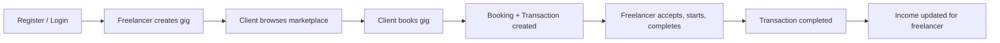

---

## 3. Tech stack

| Layer | Technology |
| --- | --- |
| Frontend | React 19, React Router 7, Vite 8 |
| Backend | Node.js, Express 5 (served over HTTPS) |
| Database | MongoDB with Mongoose 8 (local MongoDB or Atlas); `migrate-mongo` for indexes |
| Auth | `jsonwebtoken`, `bcryptjs`, `cookie-parser` |
| Security | `helmet`, `express-rate-limit`, `express-validator`, `cors` |
| Backend tests | Node.js test runner (`node --test`), Postman, Newman + `newman-reporter-htmlextra` |
| Frontend tests | Vitest, React Testing Library, `@testing-library/user-event`, jsdom |

---

## 4. Project structure

```text
.
├── README.md
├── docs/Part1-Report.md               Part 1 architecture report
├── PostmanCollection/                 Part 1 + Part 2 collections, rate-limit demo
├── NewmanReports/                     HTML reports produced by Newman
├── Screenshots/                       Application and test evidence
└── Project/
    ├── .env.example                   Backend environment template
    ├── package.json                   Root scripts (dev, seed, tests, Newman)
    ├── migrations/                    MongoDB index migrations
    ├── server/
    │   ├── app.js                     Express app: Helmet/CSP, CORS, origin check, rate limiters, routes
    │   ├── server.js                  HTTPS start-up (fails fast if config is missing)
    │   ├── config/                    Database connection, HTTPS certificate loading
    │   ├── controllers/               auth, user, gig, booking, transaction, income, admin
    │   ├── middleware/                protect, authorizeRoles, validators, error handler, API usage
    │   ├── models/                    User, Gig, Booking, Transaction, Review, Analytics, ApiUsage
    │   ├── routes/
    │   ├── scripts/                   Certificate generator, seed data
    │   └── test/                      Backend automated tests
    └── client/
        ├── vite.config.js             HTTPS dev server + CSP headers
        ├── vitest.config.js           Frontend test configuration
        └── src/
            ├── context/AuthContext.jsx
            ├── routes/                ProtectedRoute, RoleRoute
            ├── components/layout/     Navbar, Footer, Layout
            ├── pages/                 auth, marketplace, gig, bookings, transactions, dashboard, profile, admin
            ├── test/                  Test setup and helpers
            └── __tests__/             Frontend automated tests
```

---

## 5. Getting started

### Prerequisites

- Node.js 20 LTS or newer
- MongoDB running locally (`mongodb://127.0.0.1:27017`) **or** a MongoDB Atlas connection string
- OpenSSL, used once to generate the local HTTPS certificate. Git for Windows includes it.
- Postman (optional — Newman runs the same collection from the terminal)

### Step 1 — Install dependencies

```bash
cd Project
npm install
npm install --prefix server
npm install --prefix client
```

### Step 2 — Environment variables

**Backend** — create `Project/.env` (copy `Project/.env.example`):

```env
PORT=5000
CLIENT_ORIGIN=https://localhost:5173
MONGO_URI=mongodb://127.0.0.1:27017/
MONGO_DB_NAME=hustlehub_dev
JWT_SECRET=replace-with-a-long-random-string
JWT_EXPIRES_IN=1h
```

> `MONGO_DB_NAME` must contain `dev`, `local` or `test`. The seed script refuses to run on any other name, so it can never wipe a production database.
> Generate a strong secret with `node -e "console.log(require('crypto').randomBytes(48).toString('hex'))"`.

**Frontend** — create `Project/client/.env` (copy `Project/client/.env.example`):

```env
VITE_API_URL=https://localhost:5000
VITE_APP_NAME=HustleHub+
```

`.env` files and certificates are git-ignored and must never be committed.

### Step 3 — Certificate and seed data

```bash
npm run generate-cert
npm run seed
```

Seeded accounts (password `Password123!`):

| Role | Email |
| --- | --- |
| Client | `client@hustlehub.test` |
| Freelancer | `john@hustlehub.test`, `sarah@hustlehub.test` |
| Admin | `admin@hustlehub.test` |

### Step 4 — Run

```bash
npm run dev
```

| App | URL |
| --- | --- |
| Backend API | <https://localhost:5000> |
| Frontend | <https://localhost:5173> |

Both use a self-signed certificate. Open <https://localhost:5000> once and accept the browser warning, otherwise the frontend cannot reach the API. Then open <https://localhost:5173>.

To run them separately: `npm run server` and `npm run client`.

---

## 6. Backend API

The Express API is the core of the application: every business rule and every security check runs on the server.

### 6.1 Data model

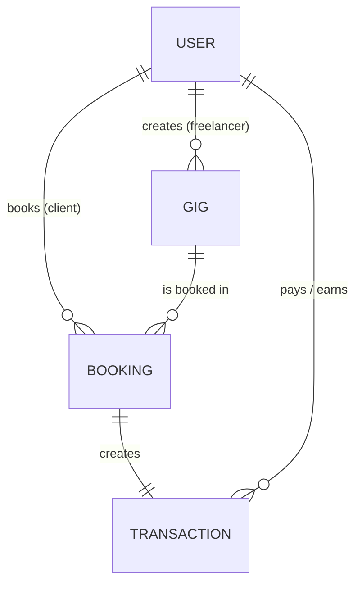

| Collection | Key fields | Notes |
| --- | --- | --- |
| `users` | name, email (unique, lowercase), password (bcrypt hash), role (`Client` / `Freelancer` / `Admin`), isActive, bio, skills, phone, location | Deactivated users cannot log in or use existing tokens |
| `gigs` | freelancerId → User, title, description, category, price, deliveryDays, location.address, status (`active` / `paused` / `deleted`), views | Delete is a soft delete, so booking history stays intact |
| `bookings` | gigId, clientId, freelancerId, agreedPrice, bookingDate, status, completedAt | `agreedPrice` is copied from the gig at booking time |
| `transactions` | bookingId (unique), clientId, freelancerId, amount, platformFee, taxAmount, freelancerAmount, status, invoiceNumber, payoutDate | Exactly one per booking |
| `apiusages` | date, endpoint, method, statusCode, successful | Written by middleware on every request |
| `reviews`, `analytics` | — | Supporting collections |

Indexes are created by the `migrate-mongo` migrations in `Project/migrations/`.

### 6.2 Booking and simulated payment

When a client books a gig (`POST /api/bookings`):

1. The server loads the gig. It must be `active`, and a freelancer cannot book their own gig.
2. A **booking** is created. The client is the logged-in user, and the price is copied **from the database** — any price in the request body is ignored.
3. A **transaction** is created and linked to the booking, the client and the freelancer:

| Field | Calculation | Example (R1 000 gig) |
| --- | --- | --- |
| `amount` | gig price | R1 000.00 |
| `platformFee` | 10% of amount | R100.00 |
| `taxAmount` | 15% of (amount − fee) | R135.00 |
| `freelancerAmount` | amount − fee − tax | R765.00 |
| `invoiceNumber` | `INV-<bookingId>` | `INV-6650…` |

If the transaction cannot be saved, the booking is rolled back, so a booking never exists without its transaction.

### 6.3 Booking lifecycle

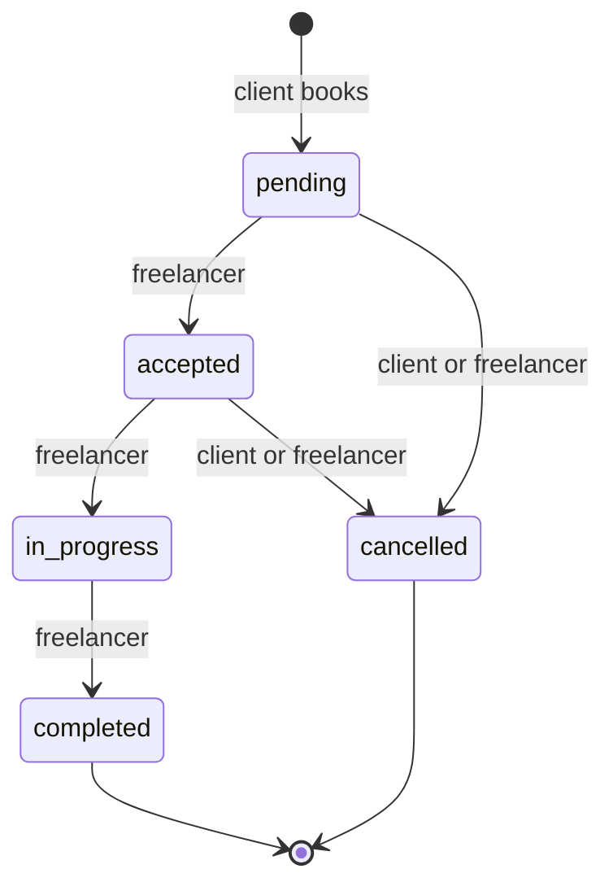

- Completing a booking sets the transaction to `completed`; cancelling sets it to `refunded`.
- Any other jump (for example `pending → completed`) is rejected with `400`.
- Admins can record a **payout** on a completed transaction (`PATCH /api/transactions/:id/payout`). It can only be done once.

### 6.4 Income tracking

`GET /api/income` returns the logged-in freelancer's totals from transactions whose booking is completed:

- **summary:** `gross`, `fees`, `tax` and `net`
- **monthlyIncome:** net income grouped by month, used by the income page

### 6.5 Admin and monitoring

- **Dashboard:** user counts by role, active gigs, bookings, completed bookings, platform revenue (fees from completed bookings) and total API requests.
- **Management:** users (role and active status — an admin cannot remove their own Admin role), gigs (pause or remove) and bookings (status).
- **API usage:** every request is logged with its endpoint, method and status code, then grouped by day and endpoint into success and failure counts.

### 6.6 Endpoint reference

All routes are relative to `https://localhost:5000`. 🔒 = valid JWT cookie required.

**Auth**

| Method | Route | Access | Description |
| --- | --- | --- | --- |
| POST | `/api/auth/register` | Public · rate limited | Register a Client or Freelancer |
| POST | `/api/auth/login` | Public · rate limited | Log in; sets the HttpOnly JWT cookie |
| GET | `/api/auth/me` | 🔒 Any role | Current user |
| POST | `/api/auth/logout` | Public | Clears the cookie |

**Users**

| Method | Route | Access | Description |
| --- | --- | --- | --- |
| GET / PUT | `/api/users/profile` | 🔒 Any role | View or update own profile |
| DELETE | `/api/users/profile` | 🔒 Any role | Deactivate own account |
| GET | `/api/users/:id` | 🔒 Any role | Public profile of a user |
| GET | `/api/users` | 🔒 Admin | List users |
| DELETE | `/api/users/:id` | 🔒 Admin | Remove a user |

**Gigs**

| Method | Route | Access | Description |
| --- | --- | --- | --- |
| GET | `/api/gigs` | Public | Active gigs (`search`, `category`, `minPrice`, `maxPrice`) |
| GET | `/api/gigs/:id` | Public | One active gig |
| GET | `/api/gigs/my-gigs` | 🔒 Freelancer | Own gigs |
| GET | `/api/gigs/my-gigs/:id` | 🔒 Freelancer (owner) | Own gig for editing (including paused) |
| POST | `/api/gigs` | 🔒 Freelancer | Create gig |
| PUT | `/api/gigs/:id` | 🔒 Freelancer (owner) | Update own gig |
| DELETE | `/api/gigs/:id` | 🔒 Freelancer (owner) | Soft-delete own gig |

**Bookings, transactions and income**

| Method | Route | Access | Description |
| --- | --- | --- | --- |
| POST | `/api/bookings` | 🔒 Client · rate limited | Book a gig and create its transaction |
| GET | `/api/bookings/my-bookings` | 🔒 Any role | Bookings where the user is client or freelancer |
| GET | `/api/bookings/:id` | 🔒 Party to booking / Admin | One booking |
| PATCH | `/api/bookings/:id/status` | 🔒 Owning freelancer (client may cancel) | Move through the lifecycle |
| GET | `/api/transactions/my-transactions` | 🔒 Any role | Own transactions |
| GET | `/api/transactions/:id` | 🔒 Party to transaction / Admin | One transaction (invoice) |
| PATCH | `/api/transactions/:id/payout` | 🔒 Admin | Record a payout |
| GET | `/api/income` | 🔒 Freelancer | Income summary and monthly breakdown |

**Admin** (all 🔒 Admin)

| Method | Route | Description |
| --- | --- | --- |
| GET | `/api/admin` | Dashboard statistics |
| GET | `/api/admin/users` | List users |
| GET / PUT | `/api/admin/users/:id` | View or update a user |
| GET | `/api/admin/gigs` | List gigs |
| PUT / DELETE | `/api/admin/gigs/:id` | Moderate or remove a gig |
| GET | `/api/admin/bookings` | List bookings |
| PUT | `/api/admin/bookings/:id` | Update a booking |
| GET | `/api/admin/analytics` | Analytics |
| GET | `/api/admin/api-usage` | API usage report |

---

## 7. Role-based access control (RBAC)

RBAC is enforced **on the server**. The React route guards only improve the user experience — hiding a link is not security.

### 7.1 How a request is authorised

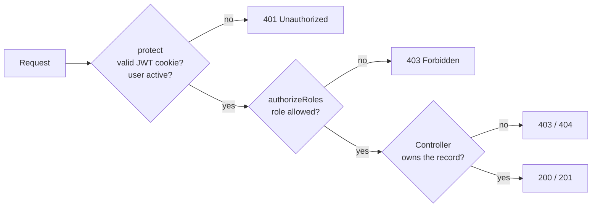

```js
// middleware/authMiddleware.js
const authorizeRoles = (...allowedRoles) => (req, res, next) => {
  if (!req.user || !allowedRoles.includes(req.user.role)) {
    return res.status(403).json({ message: "You do not have permission to perform this action." });
  }
  next();
};

// routes/gigRoutes.js
router.post("/", protect, authorizeRoles("Freelancer"), validateGig, createGig);
```

### 7.2 Role rules

| Rule | Where |
| --- | --- |
| Only **Freelancers** create, edit or delete gigs and see income | `gigRoutes.js`, `incomeRoutes.js` |
| Only **Clients** create bookings | `bookingRoutes.js` |
| Only **Admins** reach `/api/admin/*`, list or delete users, and record payouts | `adminRoutes.js`, `userRoutes.js`, `transactionRoutes.js` |
| Public registration accepts only `Client` or `Freelancer` — never `Admin` | `validateRegistration.js`, `authController.js` |
| An admin cannot remove their own Admin role | `adminController.js` |

### 7.3 Ownership — users cannot touch data that isn't theirs

| Resource | Check | Result for a non-owner |
| --- | --- | --- |
| Gig update / delete / edit view | Query filter includes `freelancerId: req.user.id` | `404 Not found` (existence is not revealed) |
| Booking view | User must be the client, the freelancer or an admin | `403` |
| Booking status change | Only the owning freelancer; the owning client may only cancel | `403` |
| Transaction view | User must be the client, the freelancer or an admin | `403` |
| Lists (my gigs, bookings, transactions, income) | Always filtered by the logged-in user's ID | Only own records returned |

The owner and the price are **never taken from the request body**: `freelancerId`, `clientId` and all money values come from the token and the database, so they cannot be spoofed.

---

## 8. API security — JWT, validation and sanitisation

### 8.1 Authentication with JWT

- Passwords are hashed with **bcrypt** (10 salt rounds) and never returned by the API.
- After login the server signs a JWT that contains only the user ID and role, and expires after 1 hour (`JWT_EXPIRES_IN`).
- The token is stored in a cookie with these flags:

  | Flag | Protection |
  | --- | --- |
  | `HttpOnly` | JavaScript cannot read the token, so XSS cannot steal it |
  | `Secure` | Sent over HTTPS only |
  | `SameSite=Lax` | Not sent on cross-site POST requests (CSRF) |

  The frontend never stores tokens in `localStorage`.
- `protect` verifies the signature and expiry on every protected request, then reloads the user from the database. Deleted or deactivated accounts are rejected immediately, even while their token is still valid.
- Login failures always return `Invalid email or password.`, so attackers cannot find out which emails are registered.
- `server.js` refuses to start without `MONGO_URI` and `JWT_SECRET`, and secrets live only in git-ignored `.env` files.

### 8.2 Input validation and sanitisation

| Input | Validation |
| --- | --- |
| Registration | `express-validator`: name 2–100 characters with no `<` or `>`; valid email (trimmed and normalised); password 8–128 characters with uppercase, lowercase, number and special character; role `Client` or `Freelancer` |
| Login | Email and password must be strings of a valid length — objects are rejected |
| Gig | Text fields must be strings of a limited length with no `<` or `>`; price a number from 0 to 10 000 000 with at most 2 decimals; delivery 1–365 days; image URL must start with `http(s)://`; status `active` or `paused` |
| Booking | `gigId` must be a valid ObjectId; date from today up to 1 year ahead |
| Profile | Name, phone, bio, skills and location are type- and length-checked, with no `<` or `>` |
| URL IDs | `validateId` rejects invalid ObjectIds before the database is queried |
| Search | Trimmed, limited to 80 characters and regex-escaped |
| Body size | JSON limited to 32 KB (`413` if larger); malformed JSON returns `400` |

**How this stops injection and scripting attacks:**

- **NoSQL injection** — operator objects such as `{"$gt": ""}` fail the type checks, so they never reach a MongoDB query.
- **XSS** — tags are rejected at input. React also escapes everything it renders, and no page uses `dangerouslySetInnerHTML`. The CSP (section 9) is a further layer.
- **Information leakage** — validation errors return field names and messages but never the submitted values, so passwords are not echoed back.

### 8.3 CSRF and CORS

- **CORS** allows only `CLIENT_ORIGIN`, with credentials.
- Any `POST`, `PUT`, `PATCH` or `DELETE` whose `Origin` header is not the trusted client is rejected with `403 Request origin is not allowed.` This adds to the protection from `SameSite=Lax` cookies.

### 8.4 Safe error handling

A central error handler returns controlled JSON for `400`, `401`, `403`, `404`, `409`, `413` and `500`. Stack traces, Mongoose errors, file paths and connection strings are never sent to the client, and unexpected errors are logged without credentials. Public gig listings populate only a freelancer's name, picture and rating — never their email or password.

---

## 9. Rate limiting and security headers

### 9.1 Rate limiting

`express-rate-limit` is configured in `app.js`:

| Endpoint | Limit (per IP) | Response when exceeded |
| --- | --- | --- |
| `POST /api/auth/login`, `POST /api/auth/register`, `POST /api/users` | 30 requests / 15 minutes | `429` `{"message":"Too many authentication attempts. Try again later."}` |
| `POST /api/bookings` | 20 bookings / hour | `429` `{"message":"Booking limit reached. Try again later."}` |

- The login limit slows brute-force and credential-stuffing attacks. The booking limit stops automated booking spam.
- Every response carries the standard `RateLimit` and `RateLimit-Policy` headers (IETF draft-7), so clients can see the limit and how many requests are left. Legacy `X-RateLimit-*` headers are turned off.
- The frontend shows the 429 message to the user (tested in `NewBooking.test.jsx`).

```js
const loginLimiter = rateLimit({
  windowMs: 15 * 60 * 1000,
  limit: 30,
  standardHeaders: "draft-7",
  legacyHeaders: false,
  message: { message: "Too many authentication attempts. Try again later." }
});
```

### 9.2 Security headers (Helmet)

Helmet runs before every route.

| Header | Protects against |
| --- | --- |
| `Content-Security-Policy` | XSS, injected scripts, clickjacking, data exfiltration |
| `Strict-Transport-Security` | Downgrade to HTTP |
| `X-Content-Type-Options: nosniff` | MIME-type sniffing |
| `X-Frame-Options` | Clickjacking |
| `Referrer-Policy` | Leaking URLs to other sites |
| `Cross-Origin-Opener-Policy`, `Cross-Origin-Resource-Policy` | Cross-origin attacks |
| `X-Powered-By` removed | Revealing that the server runs Express |

### 9.3 Content Security Policy

**API CSP** (`app.js`):

```text
default-src 'self'; base-uri 'self'; object-src 'none'; frame-ancestors 'none';
script-src 'self'; style-src 'self'; img-src 'self' data: https:;
connect-src 'self' https://localhost:5173
```

**Frontend CSP** (`vite.config.js`), sent by the Vite server:

| Directive | Preview / production | Development |
| --- | --- | --- |
| `script-src` | `'self'` | `'self' 'unsafe-inline'` (React refresh preamble) |
| `style-src` | `'self' 'unsafe-inline'` | same |
| `connect-src` | `'self'` + API origin | + `wss://localhost:5173` (hot reload) |
| `object-src` / `frame-ancestors` / `base-uri` | `'none'` / `'none'` / `'self'` | same |

Scripts can load only from the app itself, plugins and framing are blocked, `<base>` tags cannot redirect links, and the page can only send data to its own API.

---

## 10. React frontend

The frontend is a React 19 single-page app built with Vite and React Router 7. It runs over HTTPS in development.

### 10.1 Pages

| Area | Route | Page |
| --- | --- | --- |
| Public | `/` | Home / landing page |
| | `/marketplace` | Browse gigs with search and category filter |
| | `/gigs/:id` | Gig details with a "Book" action |
| | `/login`, `/signup` | Authentication |
| Any logged-in user | `/profile` | View, edit or deactivate profile |
| | `/bookings` | Bookings list with status actions |
| Client and Freelancer | `/transactions` | Transaction history |
| Client | `/bookings/new?gigId=` | Booking confirmation (simulated payment) |
| Freelancer | `/dashboard` | Income summary, recent activity, quick actions |
| | `/my-gigs`, `/create-gig`, `/gigs/:id/edit` | Gig management (create, edit, pause, delete) |
| | `/income` | Income breakdown and monthly income |
| Admin | `/admin` | Dashboard |
| | `/admin/users`, `/admin/users/:id/edit` | User management |
| | `/admin/gigs`, `/admin/bookings` | Moderation |
| | `/admin/analytics`, `/admin/api-usage` | Reports |
| Any | `*` | Not found page |

### 10.2 Authentication and route protection

- **`AuthContext`** restores the session on load by calling `/api/auth/me` with `credentials: "include"`. The token itself stays in the HttpOnly cookie and never reaches JavaScript.
- **`ProtectedRoute`** shows a loading state while the session is restored, then sends logged-out users to `/login`.
- **`RoleRoute`** sends users away from pages for other roles.
- After login, users are redirected by role: Admin → `/admin`, Freelancer → `/dashboard`, Client → `/`.
- The **Navbar** only shows links for the current role and includes Logout.

### 10.3 Usability and safe input handling

- Every data page has **loading**, **empty** and **error** states (for example "No bookings yet").
- API error messages are shown as given (for example "Invalid email or password." or the 429 message). The UI never shows stack traces or tokens.
- Forms use HTML5 validation (`required`, `type="email"`, a minimum date) and client checks such as password confirmation and numeric price. The server still validates everything.
- Destructive actions (deleting a gig, deactivating a user) ask for confirmation first.
- Booking sends only `gigId` and the date. The price shown is for display only and is never trusted by the API.

---

## 11. Testing

| Suite | Tool | Location | Result |
| --- | --- | --- | --- |
| Backend unit/integration | `node --test` | `Project/server/test/` | 35 tests, 35 passed |
| API end-to-end | Postman + Newman | `PostmanCollection/` | 69 requests, 169 assertions |
| Rate-limit demo | Newman (35 iterations) | `PostmanCollection/` | `429` after 30 attempts |
| Frontend | Vitest + React Testing Library | `Project/client/src/__tests__/` | 6 files, 29 tests, 29 passed |

Run every command from the `Project` folder.

### 11.1 Backend automated tests

```bash
npm run test:server
```

The tests start the real Express app over HTTPS on a random port. Database calls are stubbed, so **MongoDB is not needed**.

- **`api.test.js`** (Part 1, updated for cookie auth) covers:
  - HTTPS and the certificate
  - registration validation, password hashing and duplicate handling
  - the login cookie (`HttpOnly`, `Secure`, no token in the body)
  - malformed, expired and forged JWTs, and `403` for the wrong role
  - malformed and oversized JSON, and safe 500 errors
- **`marketplace-security.test.js`** (Part 2) covers:
  - Helmet and CSP headers, and the CSRF origin check
  - RBAC for gigs, bookings, admin and income
  - ownership of gigs and transactions
  - owner spoofing and price tampering
  - transaction fee, tax and net calculation
  - XSS and NoSQL-injection rejection, and invalid IDs
  - both rate limiters returning `429`

### 11.2 Postman collection and Newman

**`HustleHub Part 2 - Secure Marketplace API`** registers fresh users on every run, then tests the full flow in folders:

| Folder | Success and failure cases |
| --- | --- |
| 0. Health & Security Headers | HTTPS; CSP, HSTS, nosniff and X-Frame-Options present; X-Powered-By hidden |
| 1. Registration & Login Validation | Valid registration; duplicate (409); weak password; XSS in name; Admin self-registration blocked; missing fields; generic login error; NoSQL injection; malformed JSON |
| 2. Freelancer — Gig Management | HttpOnly/Secure login cookie; create, update and list own gigs; bad gig data rejected; freelancer can't book or reach admin |
| 3. Client — Browse & Book | Public browsing hides private fields; regex search is escaped; client can't create, edit or delete gigs or see income; invalid bookings rejected; booking creates a transaction with server-side price and correct fees |
| 4. Freelancer — Bookings & Income | Invalid status jump rejected; accept → start → complete; transaction completed; income includes the net amount |
| 5. Ownership — Other Freelancer | A second freelancer can't edit, delete or view the first freelancer's gig, booking or transaction |
| 6. Admin | Dashboard, user list without password hashes, any transaction, all bookings |
| 7. Token & Session Security | Rejected after logout; forged JWT rejected; foreign Origin blocked; controlled 404 |

Run it with Newman (backend running, database seeded):

```bash
npm run dev          # terminal 1
npm run test:api     # terminal 2  → NewmanReports/newman-report.html
```

Run the rate-limit demo **last** — it locks login for 15 minutes; restart the server to reset it:

```bash
npm run test:ratelimit   # → NewmanReports/newman-ratelimit-report.html
```

> The main collection makes about 14 login and register calls, so it can run twice in 15 minutes before the login limit applies. Restart the backend to reset the in-memory counter.
>
> To use the Postman app instead: import the collection, turn **SSL certificate verification** off (the certificate is self-signed) and click *Run collection*. Postman handles the auth cookie automatically.

### 11.3 Frontend automated tests

```bash
npm run test:client
```

| Test file | Rendering | User interaction |
| --- | --- | --- |
| `Login.test.jsx` | Form, fields, button | Typing; wrong password shows a safe error; cookie sent; redirect by role |
| `Signup.test.jsx` | Fields; Admin not offered | Password mismatch blocked; API error shown; correct payload; redirect |
| `Marketplace.test.jsx` | Loading → gigs; `<script>` rendered as text | Search and category filters; empty state; API failure |
| `NewBooking.test.jsx` | Gig, price and location | Only `gigId` and date sent; redirect; 429 message shown |
| `RouteGuards.test.jsx` | Loading state | Logged-out → login; wrong role → home; right role sees the page |
| `Navbar.test.jsx` | Links per role | Logout calls `logout()` |

`fetch` is mocked, so these tests need neither the backend nor the database.

### 11.4 Run everything

```bash
npm run test:all     # backend + frontend automated tests
npm run test:api     # Newman (backend must be running)
```

---

## 12. Screenshots

All screenshots are stored in [`Screenshots/`](Screenshots) and were taken from the application running locally over HTTPS with the seeded database.

### 12.1 Visitor — browsing and registration


*Figure 1: The public marketplace lists active gigs with search and category filters. No login is needed to browse.*

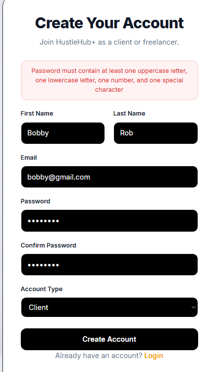

*Figure 2: Sign-up rejects a weak password. The API's validation message is shown to the user, and the submitted password is never echoed back.*

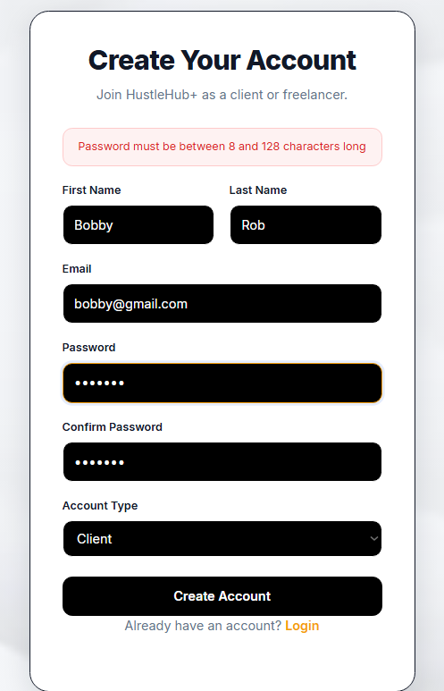

*Figure 3: Sign-up rejects a password shorter than 8 characters.*

### 12.2 Freelancer — gig management and income

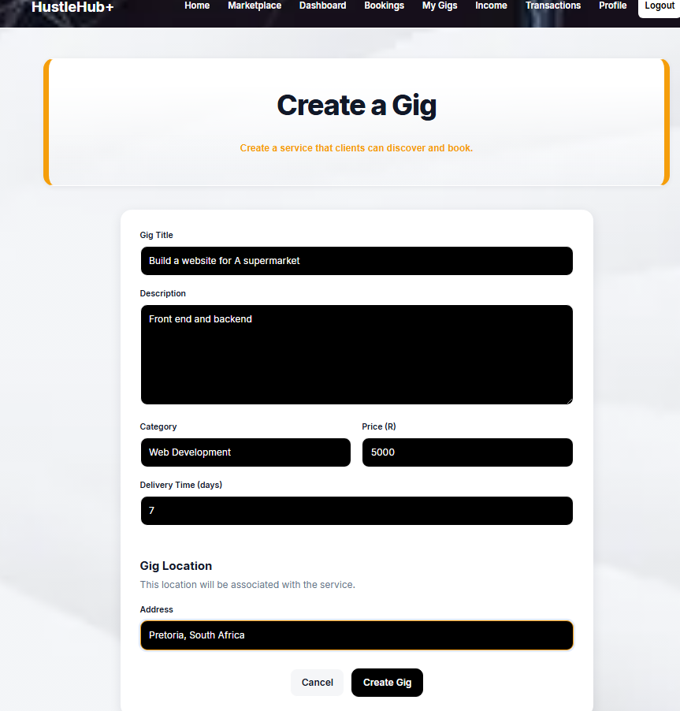

*Figure 4: A freelancer creates a gig with a title, description, category, price, delivery time and location. The server validates every field.*

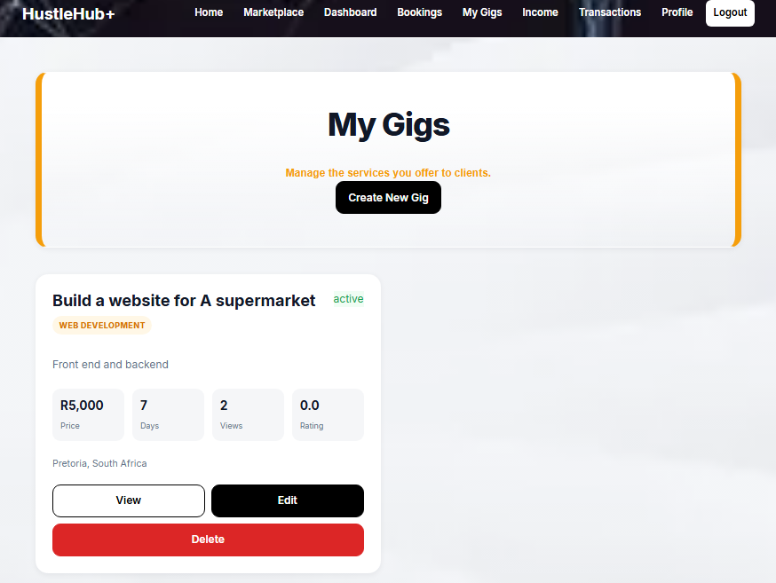

*Figure 5: My Gigs shows only the logged-in freelancer's own gigs, with View, Edit and Delete actions.*

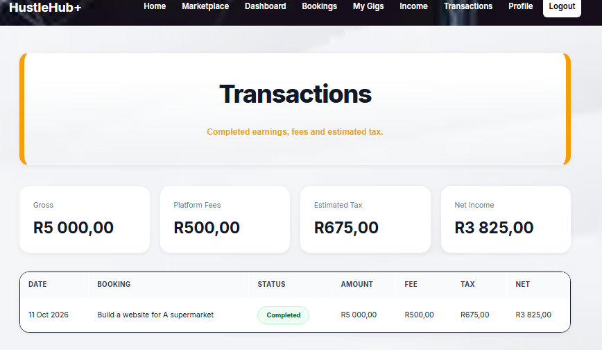

*Figure 6: The transaction record created by a completed booking: R5 000 gross, a 10% platform fee (R500), 15% tax (R675) and R3 825 net to the freelancer.*

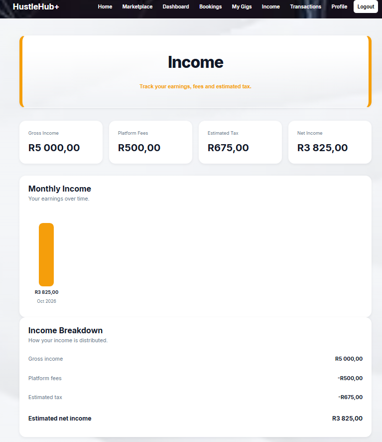

*Figure 7: Income tracking totals the freelancer's completed transactions and shows a monthly breakdown.*

### 12.3 Client — booking a gig

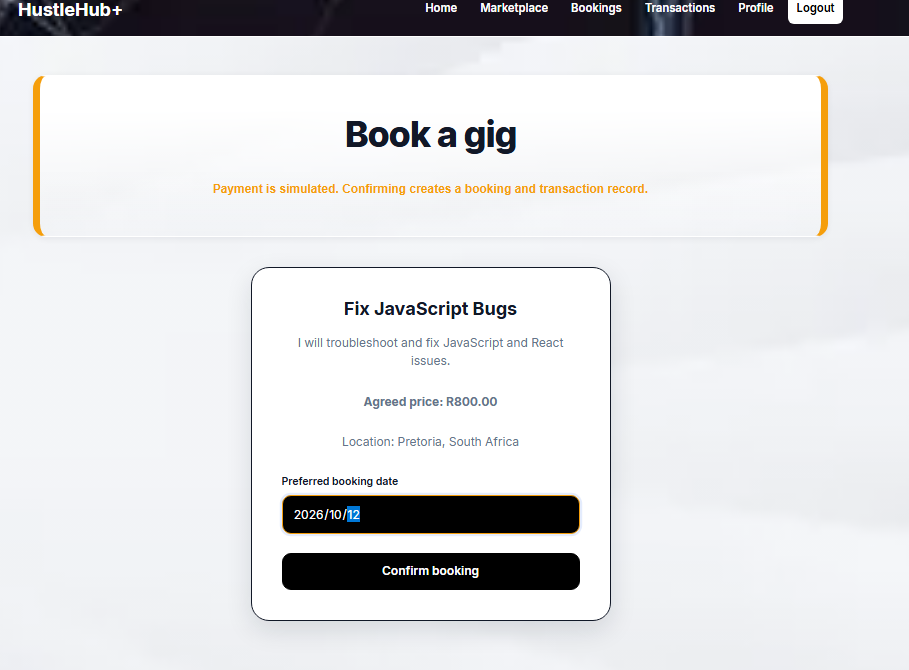

*Figure 8: A client books a gig. Payment is simulated, and the agreed price comes from the gig in the database, not from the browser.*

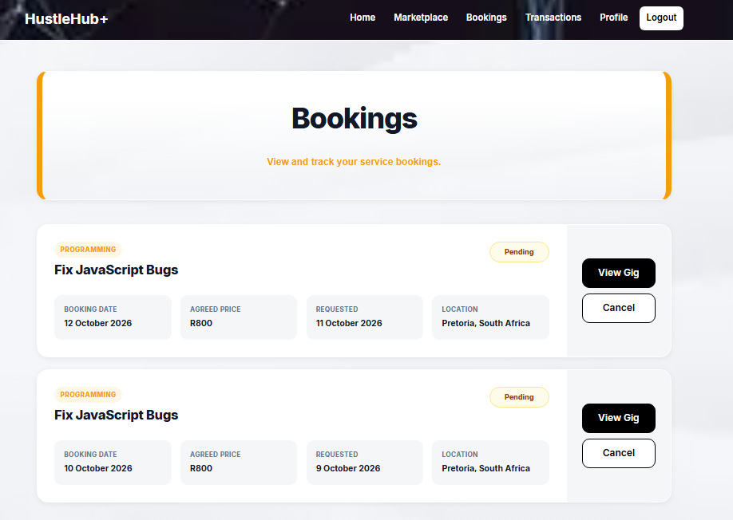

*Figure 9: The client's bookings appear as pending, with the date, price and location. The client can view the gig or cancel.*

### 12.4 Admin — platform oversight

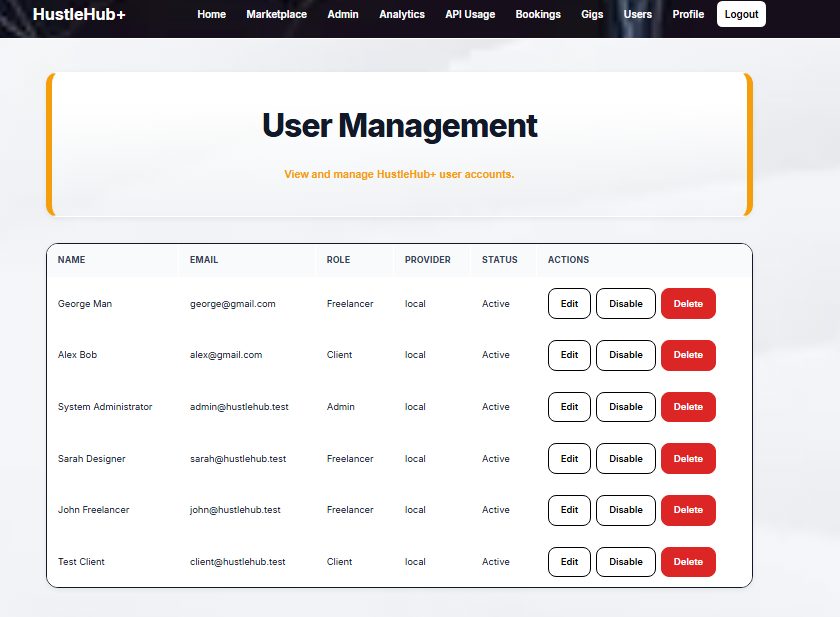

*Figure 10: Only Admins can see and manage all user accounts and their roles (Client, Freelancer, Admin).*

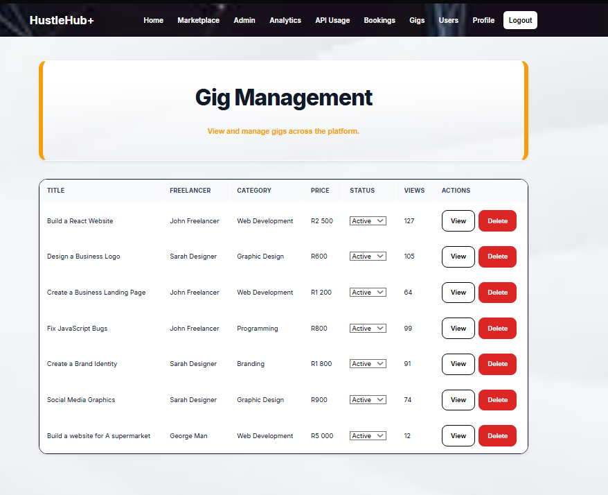

*Figure 11: Admins can moderate gigs from every freelancer.*

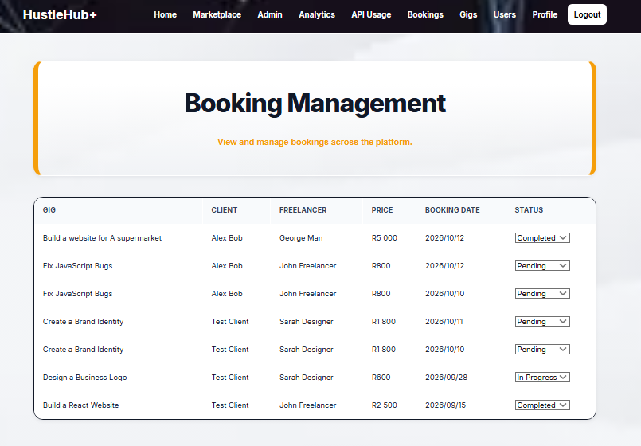

*Figure 12: Admins see every booking on the platform, including the completed R5 000 booking shown in Figure 6.*

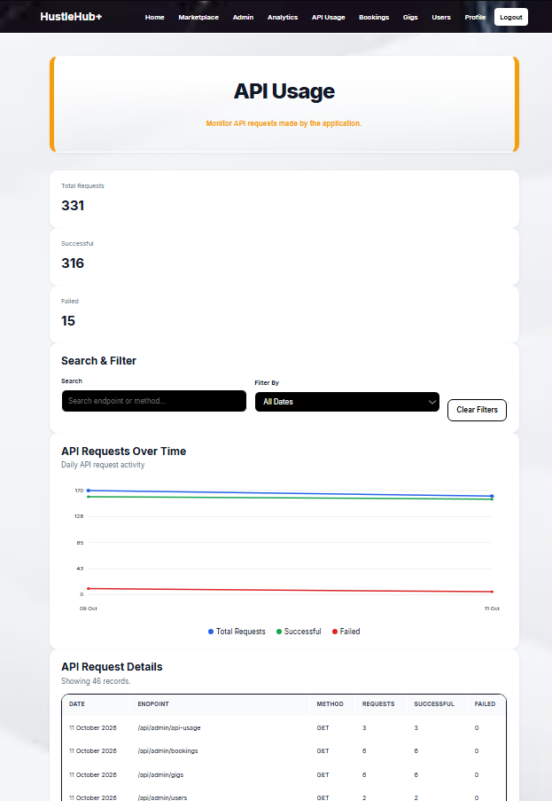

*Figure 13: API usage monitoring: every request is logged and summarised as successful or failed.*

### 12.5 Testing evidence

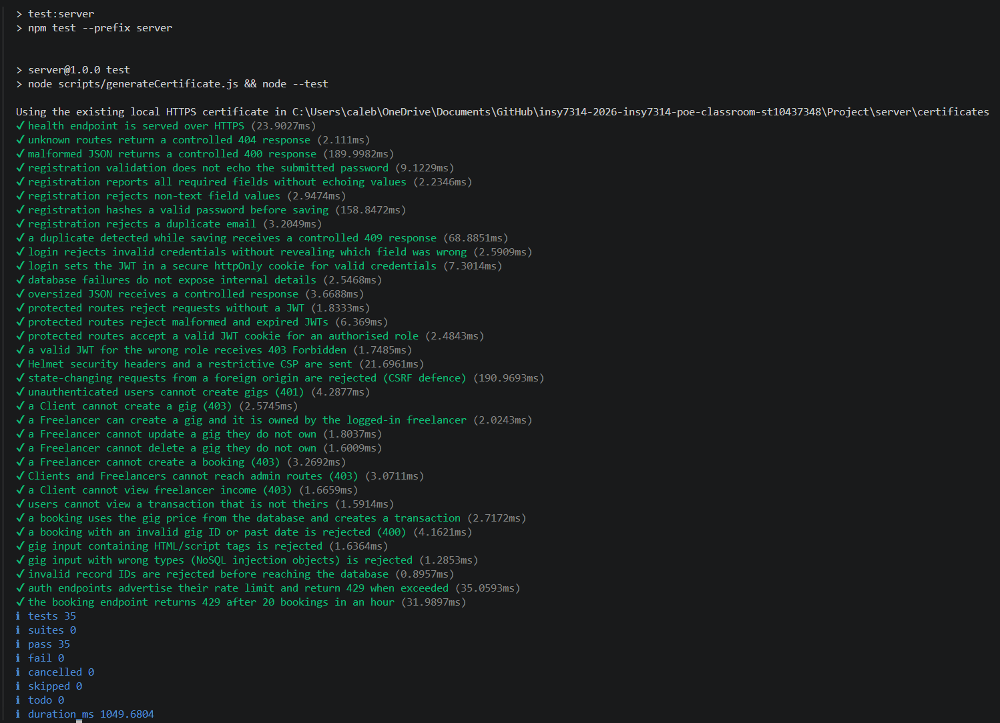

*Figure 14: Backend automated tests (`npm run test:server`): 35 passed, 0 failed. They cover HTTPS, JWT cookies, RBAC, ownership, validation, security headers and rate limiting.*

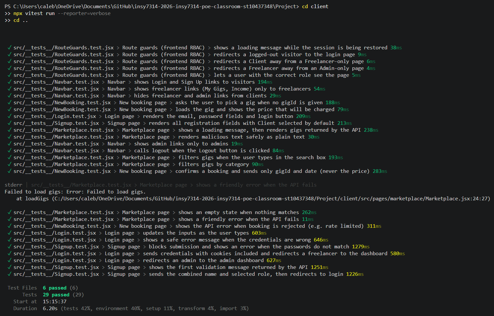

*Figure 15: Frontend tests with Vitest and React Testing Library (`npm run test:client`): 6 files, 29 tests passed. The `stderr` line is expected, because one test deliberately simulates the API failing.*

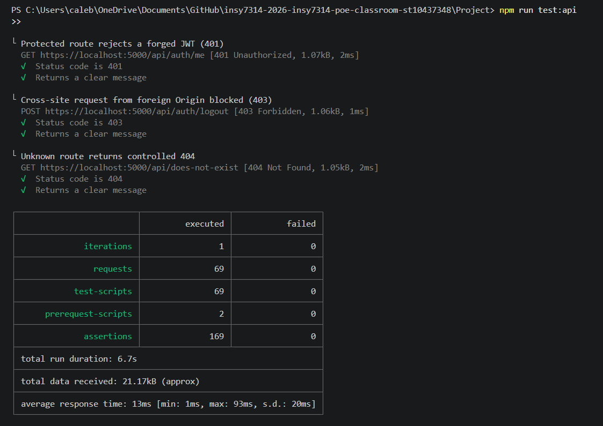

*Figure 16: The Part 2 Postman collection run with Newman (`npm run test:api`): 69 requests and 169 assertions, 0 failed.*

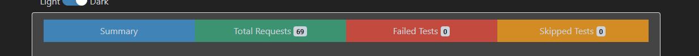

*Figure 17: The Newman htmlextra report (`NewmanReports/newman-report.html`): 69 requests, 0 failed tests, 0 skipped.*

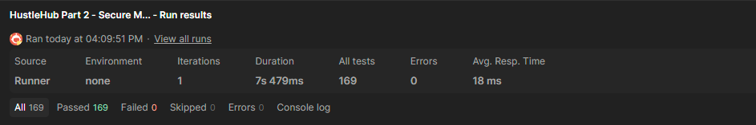

*Figure 18: The same collection run in the Postman app: 169 tests passed, 0 failed, 0 errors.*

---

## 13. Demonstration video

**Part 2 video (unlisted):** VIDEO_LINK_HERE

The video shows:

- registration and login
- freelancer gig creation
- client browsing and booking
- the booking being viewed and completed
- the transaction record and freelancer income
- RBAC rejections
- the test runs

Part 1 video: <https://youtu.be/_TZ8-mItvcw>

---

## 14. What changed from Part 1

| Area | Part 1 | Part 2 |
| --- | --- | --- |
| Scope | Backend authentication only | Full MERN marketplace: gigs, bookings, transactions, income, admin |
| Token storage | JWT in the response body, sent as `Authorization: Bearer` | `Secure` `HttpOnly` `SameSite=Lax` cookie, re-checked against the database on each request |
| Authorisation | Authentication only | RBAC (`authorizeRoles`) plus ownership checks on every resource |
| Validation | Registration and login | Plus gig, booking, profile and ID validators; HTML-tag and NoSQL-operator rejection; escaped search |
| Rate limiting | Planned | Login/register 30 per 15 min; bookings 20 per hour; `429` messages and `RateLimit` headers |
| Security headers | Planned | Helmet with a custom CSP on the API, and a CSP on the Vite server |
| CSRF | — | Origin check on state-changing requests |
| Frontend | Not built | React 19 app with protected and role routes for all three roles |
| Backend tests | 16 | 35 |
| Postman | 14 requests | 69 requests / 169 assertions with Newman, plus a rate-limit demo |
| Frontend tests | — | 29 Vitest + React Testing Library tests |

---

## 15. References

- Express. 2026. *Production best practices: security*. Available at: <https://expressjs.com/en/advanced/best-practice-security.html>
- Helmet. 2026. *Helmet.js documentation*. Available at: <https://helmetjs.github.io/>
- express-rate-limit. 2026. *express-rate-limit documentation*. Available at: <https://express-rate-limit.mintlify.app/>
- express-validator. 2026. *express-validator documentation*. Available at: <https://express-validator.github.io/docs/>
- MDN Web Docs. 2026. *Content Security Policy (CSP)*. Available at: <https://developer.mozilla.org/en-US/docs/Web/HTTP/CSP>
- OWASP Foundation. 2021. *OWASP Top 10*. Available at: <https://owasp.org/Top10/>
- OWASP Foundation. 2026. *Cheat Sheet Series: Authorization, Content Security Policy, Cross-Site Request Forgery Prevention, Input Validation*. Available at: <https://cheatsheetseries.owasp.org/>
- Postman. 2026. *Run collections using Newman CLI*. Available at: <https://learning.postman.com/docs/collections/using-newman-cli/command-line-integration-with-newman/>
- React. 2026. *React documentation*. Available at: <https://react.dev/>
- Testing Library. 2026. *React Testing Library*. Available at: <https://testing-library.com/docs/react-testing-library/intro/>
- Vitest. 2026. *Vitest guide*. Available at: <https://vitest.dev/guide/>
